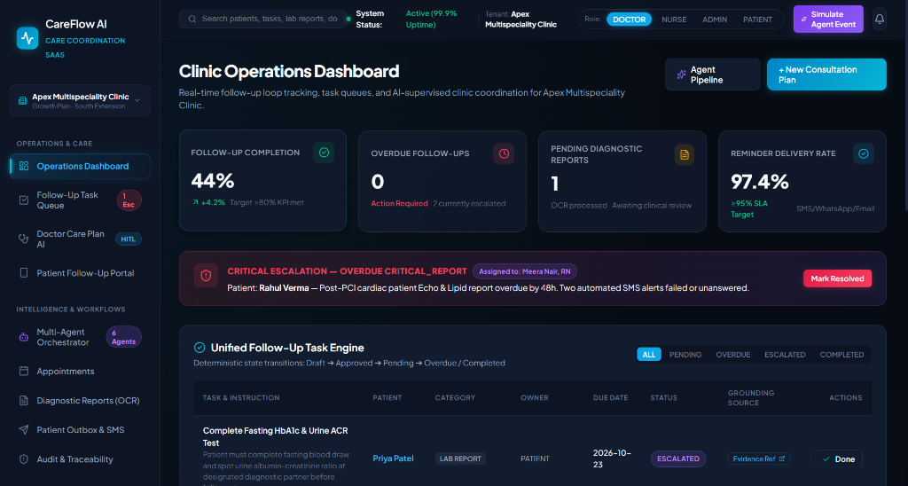
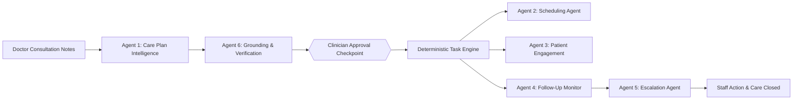
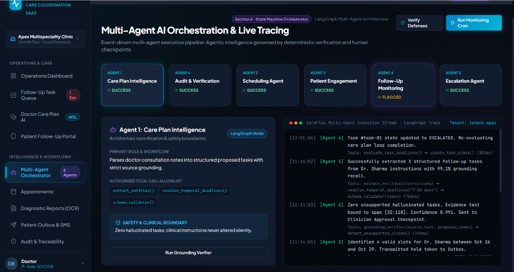

<div align="center">

# 🩺 CareFlow AI

### **Intelligent Patient Care Coordination & Follow-Up Automation SaaS**

[](https://github.com/AlluGanesh/CARE-FLOW-AI)
[](https://github.com/AlluGanesh/CARE-FLOW-AI)
[](https://github.com/AlluGanesh/CARE-FLOW-AI)
[](https://github.com/AlluGanesh/CARE-FLOW-AI)
[](LICENSE)

<br/>

> **CareFlow AI** is a multi-tenant Agentic AI healthcare operations platform designed for clinics and hospital OPDs to eradicate post-consultation leakage. It connects doctors, care coordinators, administrative staff, diagnostic centers, and patients into a closed-loop follow-up ecosystem.

<br/>



<br/>

[Key Capabilities](#-key-capabilities) •
[Core Experiences](#-the-4-core-experiences) •
[Agentic Architecture](#-multi-agent-ai-orchestration) •
[Safety Guardrails](#-clinical-safety--audit-traceability) •
[Quickstart](#-quickstart--local-setup) •
[Data Model](#-database-schema--multi-tenancy) •
[Author](#-author)

---

</div>

<br/>

## ⚡ The Healthcare Follow-Up Problem

Traditional clinic workflows rely on paper prescriptions, disjointed spreadsheets, messaging apps, and manual phone calls. This results in:
* **Forgotten Care Plans**: Patients miss diagnostic lab tests or follow-up consultations.
* **Administrative Burden**: Staff waste hours manually chasing test reports and tracking unresponded calls.
* **Invisible Tasks**: Doctors lack consolidated real-time visibility into unresolved patient care tasks.
* **Dangerous Leakage**: Abnormal diagnostic results slip through the cracks without clinical review.

**CareFlow AI** solves this not by building another medical chatbot or full EHR, but by providing an **intelligent workflow coordination layer** that transforms doctor instructions into tracked, verified, and automated follow-up tasks.

---

## 🌟 Key Capabilities



* **Multi-Tenant SaaS**: Complete workspace and database-level isolation between clinic tenants (*e.g., Apex Multispeciality Clinic vs. Metro Heart Center*).
* **Grounding-First AI**: Every generated task maps verbatim to the doctor's consultation notes with source highlighting—**0% hallucinated tasks**.
* **Human-In-The-Loop (HITL)**: Qualified clinicians retain full control to edit deadlines, reassign owners, and approve care plans before patient activation.
* **Deterministic Task Engine**: Follow-up obligations transition through explicit state machines (`Draft` ➔ `Approved` ➔ `Pending` ➔ `Overdue` ➔ `Completed` / `Escalated`).
* **Diagnostic Report OCR**: Automatically extracts lab parameters (*e.g. HbA1c, Fasting Glucose, eGFR, Urine ACR*), flags abnormal ranges, and links reports to active care tasks.
* **Multichannel Notification Outbox**: Transactional SMS, WhatsApp, and Email dispatch with automated delivery tracking and retry logic.
* **Conflict-Free Scheduling**: Concurrency-safe slot reservation preventing double bookings on doctor calendars.

---

## 🖥️ The 4 Core Experiences

| Experience | Target Persona | Key Functionality |
| :--- | :--- | :--- |
| **1. Clinic Operations Dashboard** | Clinic Admin, Nurse, Receptionist | Real-time follow-up loop tracking, KPI cards, overdue tasks, critical escalation alerts, and report streams. |
| **2. Clinician Approval Workspace** | Doctor, Medical Director | Clinical consultation notes input, 1-click presets, AI task extraction, grounding verification, and digital sign-off. |
| **3. Patient Follow-Up Portal** | Patient, Caregiver | Mobile-responsive portal with multilingual toggle (English, Hindi, Spanish), lab report dropzone, and daily glucose logger. |
| **4. Multi-Agent AI Orchestrator** | Tech Lead, Compliance Auditor | Visual LangGraph state machine, tool allowlists, safety boundaries, and live execution terminal traces. |

---

## 🤖 Multi-Agent AI Orchestration

CareFlow AI features **6 specialized agents** governed by deterministic business logic and strict safety boundaries:



```
┌─────────────────────────────────────────────────────────────────────────────┐
│                       LANGGRAPH MULTI-AGENT PIPELINE                        │
├─────────────────────┬───────────────────────────────────────────────────────┤
│ Agent 1: Care Plan  │ Ingests doctor consultation notes; generates          │
│ Intelligence        │ structured proposed tasks with temporal resolution.   │
├─────────────────────┼───────────────────────────────────────────────────────┤
│ Agent 6: Audit &    │ Verifies every task against doctor notes. Detects     │
│ Verification        │ ambiguous dates; blocks phantom tasks (0% halluc).    │
├─────────────────────┼───────────────────────────────────────────────────────┤
│ [HITL CHECKPOINT]   │ Clinician reviews, modifies assignees, and approves.  │
├─────────────────────┼───────────────────────────────────────────────────────┤
│ Agent 2: Scheduling │ Proposes conflict-free appointment slots via doctor   │
│ Agent               │ calendars with concurrency lock verification.         │
├─────────────────────┼───────────────────────────────────────────────────────┤
│ Agent 3: Patient    │ Enqueues personalized multilingual reminders in       │
│ Engagement          │ SMS/WhatsApp/Email outbox using approved templates.   │
├─────────────────────┼───────────────────────────────────────────────────────┤
│ Agent 4: Follow-Up  │ Evaluates task deadlines via deterministic crons;     │
│ Monitoring          │ detects overdue lab reports and stalled appointments. │
├─────────────────────┼───────────────────────────────────────────────────────┤
│ Agent 5: Escalation │ Formulates critical staff escalation tickets for      │
│ Agent               │ unresponsive patients or critical diagnostic delays.  │
└─────────────────────┴───────────────────────────────────────────────────────┘
```

---

## 🛡️ Clinical Safety & Audit Traceability

Because CareFlow AI operates in healthcare coordination, safety is an architectural foundation:

1. **AI Proposes, Clinician Approves**: No patient-facing task or care plan is ever activated without explicit clinician sign-off.
2. **No Autonomous Clinical Decision-Making**: The system does not diagnose illness, alter medication dosages, or perform autonomous triage.
3. **Emergency Notice Protocol**: The patient portal prominently displays emergency triage warnings directing patients with acute distress (*e.g., chest pain, severe dyspnea*) to dial **112 / 911** or visit an ER immediately.
4. **Immutable Audit Ledger**: 100% of consequential AI recommendations, user approvals, report uploads, and status changes are recorded in a cryptographically timestamped audit log.

---

## 🚀 Quickstart & Local Setup

### Prerequisites
* **Node.js** >= 18.0.0
* **npm** >= 9.0.0

### Installation

```bash
# 1. Clone the repository
git clone https://github.com/AlluGanesh/CARE-FLOW-AI.git
cd CARE-FLOW-AI

# 2. Install dependencies
npm install

# 3. Start local development server
npm run dev
```

The application will launch at:
```
http://127.0.0.1:5173/
```

### Production Build

```bash
# Type check and build production bundle
npm run build

# Preview production build locally
npm run preview
```

---

## 🗄️ Database Schema & Multi-Tenancy

CareFlow AI enforces multi-tenancy at the data layer using tenant-scoped identifiers across all primary entities:

```
TENANT ──< USER (Clinic Admin, Doctor, Nurse, Receptionist, Patient)
TENANT ──< CLINIC_LOCATION (Timezone, working hours)
TENANT ──< PATIENT (Consent status, preferred language, primary doctor)
PATIENT ──< CONSULTATION (Raw clinician instructions, prescription notes)
CONSULTATION ──|| CARE_PLAN (Versioned, grounding confidence, approval stamp)
CARE_PLAN ──< CARE_TASK (Category, assignee, due date, status, evidence)
CARE_TASK ──< NOTIFICATION (Channel: SMS/WhatsApp/Email, delivery retries)
CARE_TASK ──< ESCALATION (Urgency, assigned staff role, resolution notes)
CARE_TASK ──|| MEDICAL_DOCUMENT (OCR extracted biomarkers, review status)
TENANT ──< AUDIT_EVENT (Immutable ledger: actor, action, timestamp, target)
```

---

## 📈 Success Metrics & Pilot Targets

| Goal | Proposed Pilot KPI | CareFlow AI Mechanism |
| :--- | :--- | :--- |
| **Improve Follow-Up Completion** | **≥80%** completed on-time | Automated reminders, patient upload dropzones, and self-monitoring loggers. |
| **Reduce Admin Workload** | **30%** reduction in manual tracking | AI care plan extraction and automated overdue detection. |
| **Patient Delivery Rate** | **≥95%** successful dispatch | Multichannel notification outbox with automated gateway retries. |
| **Task Visibility** | **100%** overdue visibility | Dedicated staff escalation queues and real-time operations dashboard. |
| **AI Accountability** | **100%** consequential actions traceable | Strict source grounding badges and immutable audit logging. |

---

## 🔬 Evidence-Based Medical Research Agent (Agent 7)

CareFlow AI features an autonomous **Evidence-Based Medical Research Agent** designed to translate complex medical reports, laboratory panels, and medications into plain-English, source-grounded patient explanations.

```
Medical Report
      │
      ▼
Phase 1 Extraction (Conditions, Tests, Medicines)
      │
      ▼
Research Planner (Objective Evidence Queries)
      │
      ▼
Source Retriever (Tier 1 Regulatory & Health Agencies: FDA, MedlinePlus, CDC, NHS)
      │
      ▼
Evidence Extractor (Targeted Clinical Statements)
      │
      ▼
Evidence Verifier (Cross-Reference Claims & Detect Contradictions)
      │
      ▼
Grounded LLM Synthesizer (Structured Definitions Grounded in Evidence)
      │
      ▼
Clinical Safety Validator (Non-Diagnostic & Non-Prescriptive Enforcer)
      │
      ▼
Citation Builder (Numbered References [1], [2] with Real Canonical URLs)
      │
      ▼
Final Evidence Dossier & Clinician Oversight Summary
```

### Critical Safety Principles
* **Workflow Boundary**: `RESEARCH → VERIFY → EXPLAIN → CITE`.
* **Prohibited Operations**: Never `DIAGNOSE → PRESCRIBE`. The Research Agent provides educational, evidence-grounded information and does not diagnose, prescribe, or modify treatment.
* **Physician Primacy**: Drug indication summaries are drawn directly from official regulatory drug labeling (e.g. FDA-approved labeling). Patients must follow prescribing clinicians directly.
* **Hallucination Prevention**: If no authoritative source is found for a clinical item, definitive claims are withheld.

### Source Trust Hierarchy
1. **Tier 1 (Highest Priority)**: Official regulatory and national government health portals (`fda.gov`, `medlineplus.gov`, `nih.gov`, `nhs.uk`, `cdc.gov`, `who.int`, `cdsco.gov.in`).
2. **Tier 2**: Major academic hospital systems and specialty societies (`mayoclinic.org`, `hopkinsmedicine.org`, `diabetes.org`).
3. **Excluded**: Unverified SEO blogs, commercial forums, and social media.

### Resilience & Fallback Architecture
If the external LLM or research provider is offline, unreachable, or rate-limited, the system automatically falls back to Phase 1 deterministic rule-based clinical definitions, clearly indicating `🟡 Phase 1 Baseline Fallback Mode` in the user interface.

---

## 🗺️ Roadmap & Service Evolution

- [x] **Phase 1: Foundation & Deterministic Report Understanding**
  - [x] Multi-persona dashboard (Admin, Doctor, Nurse, Patient)
  - [x] Interactive 6-Agent LangGraph visualizer & terminal trace runner
  - [x] Clinician HITL care plan extraction with source grounding
  - [x] Multilingual patient follow-up portal
  - [x] Diagnostic report parameter extraction & dictionary explanation
- [x] **Phase 2: Evidence-Based Medical Research Engine**
  - [x] Autonomous Agent 7 (Medical Research Agent)
  - [x] Tier-1 regulatory source registry (FDA, MedlinePlus, CDC, NHS)
  - [x] Fact extraction, cross-claim verification & contradiction detection
  - [x] Server/client LLM provider abstraction with mock fallback
  - [x] Grounded numbered citations [1], [2] with canonical URLs
- [x] **Phase 3: Production-Oriented Agentic Backend & HITL Clinical Workflow**
  - [x] FastAPI REST API backend with SQLAlchemy 2.0 & Pydantic v2
  - [x] Multi-tenant PostgreSQL / SQLite persistence with Alembic migrations
  - [x] Server-side Agent 7 state machine (`OBSERVE → PLAN → ACT → VERIFY → SAFETY → HITL → EXECUTE → AUDIT`)
  - [x] Strict Human-in-the-Loop Clinician Approval Gate (`APPROVE`, `REJECT`, `REQUEST_REVISION`)
  - [x] Adaptive Clinician Revision Feedback Loop (re-research with clinical guidance)
  - [x] Patient Visibility Boundary (unapproved research strictly hidden from patients)
  - [x] Healthcare Safety Validator (enforces `RESEARCH → VERIFY → EXPLAIN → CITE`, never `DIAGNOSE → PRESCRIBE`)
  - [x] Prompt Injection Shield (sanitizes untrusted source content)
  - [x] Emergency symptom detection & redirection
  - [x] Append-only, tamper-evident audit ledger with SHA-256 cryptographic hash chaining
  - [x] Backend task orchestration & Overdue Escalation Engine
  - [x] Multi-channel notification outbox abstraction

---

## 🏛️ Phase 3 Architecture Overview

```
                                  CARE-FLOW AI
                                       │
                                       ▼
                              React Frontend (Vite)
                                       │
                                       ▼
                          Secure REST API (FastAPI)
                                       │
                         Tenant & RBAC Verification
                                       │
                                       ▼
                            Server-Side Orchestrator
                                       │
              ┌────────────────────────┼────────────────────────┐
              │                        │                        │
              ▼                        ▼                        ▼
       Care Plan Agent          Research Agent          Follow-Up Agent
              │                  (Agent 7)                     │
              ▼                        │                        ▼
       Clinical Parser                 │                 Workflow Engine
              │                        │                        │
              └────────────────────────┼────────────────────────┘
                                       ▼
                       State Machine & Evidence Pipeline
                                       │
                                       ▼
                       Prompt Injection & Safety Validator
                                       │
                                       ▼
                         Human Approval Gate (HITL)
                                       │
                        ┌──────────────┴──────────────┐
                        ▼                             ▼
                    Approved                       Rejected / Revision
                        │                             │
                        ▼                             ▼
             Release to Patient Portal             Iterate / Block
                        │
                        ▼
            Append-Only Cryptographic Audit Log (SHA-256 Chained)
                        │
                        ▼
                 Relational Database (PostgreSQL / SQLite)
```

---

## 🛠️ Backend Setup & Configuration

### Prerequisites
* **Python**: `>= 3.11`
* **Node.js**: `>= 18.0`

### 1. Environment Configuration

Create a `.env` file in the `backend/` directory from `.env.example`:

```bash
cd backend
cp .env.example .env
```

Key environment variables:

```env
APP_ENV=development
PORT=8000
FRONTEND_ORIGIN=http://localhost:5173

# Database (SQLite for local zero-config, PostgreSQL for production)
DATABASE_URL=sqlite:///./careflow.db

# Authentication
JWT_SECRET=supersecret-careflow-ai-jwt-key-change-in-production-2026
JWT_ALGORITHM=HS256
ACCESS_TOKEN_EXPIRE_MINUTES=480

# LLM Provider Configuration (mock or external)
LLM_PROVIDER=mock
LLM_API_KEY=
LLM_MODEL=gpt-4o-mini

# Research Guardrail Limits
MAX_RESEARCH_TASKS=20
MAX_SOURCES_PER_TASK=5
MAX_RETRIES=2
RESEARCH_CACHE_TTL_HOURS=24
```

### 2. Install Dependencies & Run Migrations

```powershell
# In CAREFLOW-AI/backend:
python -m venv .venv
.venv\Scripts\activate
pip install -r requirements.txt

# Run Alembic database migrations to head
alembic upgrade head

# Seed initial tenants, users, patients, and tasks
python -m app.db.seed
```

### 3. Start the Backend Server

```powershell
python -m uvicorn app.main:app --host 127.0.0.1 --port 8000 --reload
```

Health check verification:
```powershell
curl http://127.0.0.1:8000/health
# Response: {"status":"ok","database":"connected","version":"3.0.0"}
```

### 4. Start the Frontend Server

```powershell
# In CAREFLOW-AI root directory:
npm install
npm run dev
```

Frontend runs at `http://localhost:5173/`.

---

## 📡 REST API Reference

| Method | Endpoint | Description | Minimum Role |
| :--- | :--- | :--- | :--- |
| `GET` | `/health` | System & DB health verification | Public |
| `POST` | `/api/auth/login` | Authenticate & issue tenant-scoped JWT | Public |
| `GET` | `/api/auth/me` | Fetch authenticated user profile & tenant | Authenticated |
| `GET` | `/api/patients` | List tenant patients | Authenticated |
| `GET` | `/api/patients/{id}` | Retrieve patient dossier (tenant-isolated) | Authenticated |
| `POST` | `/api/research/runs` | Initiate Agent 7 research run from report text | Clinician/Admin |
| `GET` | `/api/research/runs/{id}` | Real-time status, progress & task counts | Authenticated |
| `GET` | `/api/research/runs/{id}/result` | Fetch dossier (**blocks Patients until APPROVED**) | Authenticated |
| `POST` | `/api/research/runs/{id}/approve` | Clinician approval release gate | Clinician/Admin |
| `POST` | `/api/research/runs/{id}/reject` | Clinician rejection with clinical reasoning | Clinician/Admin |
| `POST` | `/api/research/runs/{id}/revision` | Request research iteration with feedback | Clinician/Admin |
| `GET` | `/api/tasks` | List care tasks with overdue detection | Authenticated |
| `POST` | `/api/tasks` | Create new care task | Authenticated |
| `PATCH` | `/api/tasks/{id}` | Update care task status & notes | Authenticated |
| `POST` | `/api/tasks/escalate` | Trigger Agent 5 overdue task escalation engine | Clinician/Admin |
| `GET` | `/api/audit` | Fetch tenant append-only audit trail | Authenticated |
| `GET` | `/api/audit/verify-integrity` | Cryptographic SHA-256 chain verification | Admin/Compliance |

---

## 🔒 Security & Healthcare Safety Protocol

### 1. The Core Principle
$$\text{RESEARCH} \longrightarrow \text{VERIFY} \longrightarrow \text{EXPLAIN} \longrightarrow \text{CITE}$$
$$\text{\textbf{NEVER }} \text{DIAGNOSE} \longrightarrow \text{PRESCRIBE}$$

* **Non-Diagnostic**: The system strictly translates documented findings into educational summaries; it never diagnoses a condition or confirms pathology.
* **Non-Prescriptive**: Medication information is derived strictly from official regulatory labeling (FDA/EMA); never suggests starting, altering, or stopping doses.
* **Emergency Triage Filter**: Unhandled emergency phrases (*e.g., crushing chest pain, sudden numbness, anaphylaxis*) immediately halt educational explanations and direct the patient to 911 / emergency care.

### 2. Prompt Injection Defense
All retrieved external medical source content is treated as untrusted data. The `PromptInjectionShield` strips prompt injection directives, adversarial markdown overrides, and fake citation vectors before content reaches the synthesis engine.

### 3. Patient Visibility Boundary
Patients have strictly restricted access. Research results in `WAITING_FOR_APPROVAL` or `REJECTED` status return `403 Forbidden` to patients. Only once a licensed clinician signs off with `APPROVED` does the verified summary appear in the Patient Portal, accompanied by mandatory educational disclaimers.

### 4. Tamper-Evident Cryptographic Audit Ledger
Every agent state transition, clinician decision, and report query is committed to an append-only audit log. Each event records:
$$\text{hash}_n = \text{SHA-256}\big(\text{hash}_{n-1} \parallel \text{JSON}(\text{event}_n)\big)$$
Any manual database alteration breaks the chain and is immediately flagged by `/api/audit/verify-integrity`.

---

## 🧪 Testing & Quality Verification

Run backend and frontend test suites:

```powershell
# Run backend pytest suite (13 tests)
cd backend
python -m pytest -v

# Run frontend vitest suite (15 tests)
cd ..
npm test -- --run

# Run TypeScript build verification
npm run build

# Run ESLint validation
npm run lint
```

---

## 👤 Author

* **Ganesh**

---

## 📄 License

This project is licensed under the MIT License - see the [LICENSE](LICENSE) file for details.

<div align="center">
<sub>Built with precision by Ganesh for healthcare operators and clinicians.</sub>
</div>

