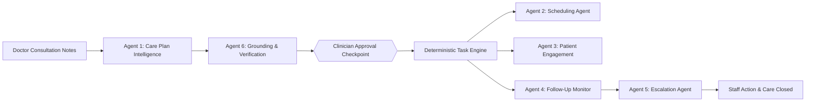

<div align="center">

# 🩺 CareFlow AI

### **Intelligent Patient Care Coordination & Follow-Up Automation SaaS**

[](https://github.com/Harshith-ka/CareFlow-Ai)
[](https://github.com/Harshith-ka/CareFlow-Ai)
[](https://github.com/Harshith-ka/CareFlow-Ai)
[](https://github.com/Harshith-ka/CareFlow-Ai)
[](LICENSE)

<br/>

> **CareFlow AI** is a multi-tenant Agentic AI healthcare operations platform designed for clinics and hospital OPDs to eradicate post-consultation leakage. It connects doctors, care coordinators, administrative staff, diagnostic centers, and patients into a closed-loop follow-up ecosystem.

<br/>

[Key Capabilities](#-key-capabilities) •
[Core Experiences](#-the-4-core-experiences) •
[Agentic Architecture](#-multi-agent-ai-orchestration) •
[Safety Guardrails](#-clinical-safety--audit-traceability) •
[Quickstart](#-quickstart--local-setup) •
[Data Model](#-database-schema--multi-tenancy)

---

</div>

<br/>

## ⚡ The Healthcare Follow-Up Problem

Traditional clinic workflows rely on paper prescriptions, disjointed spreadsheets, messaging apps, and manual phone calls. This results in:
* **Forgotten Care Plans**: Patients miss diagnostic lab tests or follow-up consultations.
* **Administrative Burden**: Staff waste hours manually chasing test reports and tracking unresponded calls.
* **Invisible Tasks**: Doctors lack consolidated real-time visibility into unresolved patient care tasks.
* **Dangerous Leakage**: Abnormal diagnostic results slip through the cracks without clinical review.

**CareFlow AI** solves this not by building another medical chatbot or full EHR, but by providing an **intelligent workflow coordination layer** that transforms doctor instructions into tracked, verified, and automated follow-up tasks.

---

## 🌟 Key Capabilities



* **Multi-Tenant SaaS**: Complete workspace and database-level isolation between clinic tenants (*e.g., Apex Multispeciality Clinic vs. Metro Heart Center*).
* **Grounding-First AI**: Every generated task maps verbatim to the doctor's consultation notes with source highlighting—**0% hallucinated tasks**.
* **Human-In-The-Loop (HITL)**: Qualified clinicians retain full control to edit deadlines, reassign owners, and approve care plans before patient activation.
* **Deterministic Task Engine**: Follow-up obligations transition through explicit state machines (`Draft` ➔ `Approved` ➔ `Pending` ➔ `Overdue` ➔ `Completed` / `Escalated`).
* **Diagnostic Report OCR**: Automatically extracts lab parameters (*e.g. HbA1c, Fasting Glucose, eGFR, Urine ACR*), flags abnormal ranges, and links reports to active care tasks.
* **Multichannel Notification Outbox**: Transactional SMS, WhatsApp, and Email dispatch with automated delivery tracking and retry logic.
* **Conflict-Free Scheduling**: Concurrency-safe slot reservation preventing double bookings on doctor calendars.

---

## 🖥️ The 4 Core Experiences

| Experience | Target Persona | Key Functionality |
| :--- | :--- | :--- |
| **1. Clinic Operations Dashboard** | Clinic Admin, Nurse, Receptionist | Real-time follow-up loop tracking, KPI cards, overdue tasks, critical escalation alerts, and report streams. |
| **2. Clinician Approval Workspace** | Doctor, Medical Director | Clinical consultation notes input, 1-click presets, AI task extraction, grounding verification, and digital sign-off. |
| **3. Patient Follow-Up Portal** | Patient, Caregiver | Mobile-responsive portal with multilingual toggle (English, Hindi, Spanish), lab report dropzone, and daily glucose logger. |
| **4. Multi-Agent AI Orchestrator** | Tech Lead, Compliance Auditor | Visual LangGraph state machine, tool allowlists, safety boundaries, and live execution terminal traces. |

---

## 🤖 Multi-Agent AI Orchestration

CareFlow AI features **6 specialized agents** governed by deterministic business logic and strict safety boundaries:

```
┌─────────────────────────────────────────────────────────────────────────────┐
│                       LANGGRAPH MULTI-AGENT PIPELINE                        │
├─────────────────────┬───────────────────────────────────────────────────────┤
│ Agent 1: Care Plan  │ Ingests doctor consultation notes; generates          │
│ Intelligence        │ structured proposed tasks with temporal resolution.   │
├─────────────────────┼───────────────────────────────────────────────────────┤
│ Agent 6: Audit &    │ Verifies every task against doctor notes. Detects     │
│ Verification        │ ambiguous dates; blocks phantom tasks (0% halluc).    │
├─────────────────────┼───────────────────────────────────────────────────────┤
│ [HITL CHECKPOINT]   │ Clinician reviews, modifies assignees, and approves.  │
├─────────────────────┼───────────────────────────────────────────────────────┤
│ Agent 2: Scheduling │ Proposes conflict-free appointment slots via doctor   │
│ Agent               │ calendars with concurrency lock verification.         │
├─────────────────────┼───────────────────────────────────────────────────────┤
│ Agent 3: Patient    │ Enqueues personalized multilingual reminders in       │
│ Engagement          │ SMS/WhatsApp/Email outbox using approved templates.   │
├─────────────────────┼───────────────────────────────────────────────────────┤
│ Agent 4: Follow-Up  │ Evaluates task deadlines via deterministic crons;     │
│ Monitoring          │ detects overdue lab reports and stalled appointments. │
├─────────────────────┼───────────────────────────────────────────────────────┤
│ Agent 5: Escalation │ Formulates critical staff escalation tickets for      │
│ Agent               │ unresponsive patients or critical diagnostic delays.  │
└─────────────────────┴───────────────────────────────────────────────────────┘
```

---

## 🛡️ Clinical Safety & Audit Traceability

Because CareFlow AI operates in healthcare coordination, safety is an architectural foundation:

1. **AI Proposes, Clinician Approves**: No patient-facing task or care plan is ever activated without explicit clinician sign-off.
2. **No Autonomous Clinical Decision-Making**: The system does not diagnose illness, alter medication dosages, or perform autonomous triage.
3. **Emergency Notice Protocol**: The patient portal prominently displays emergency triage warnings directing patients with acute distress (*e.g., chest pain, severe dyspnea*) to dial **112 / 911** or visit an ER immediately.
4. **Immutable Audit Ledger**: 100% of consequential AI recommendations, user approvals, report uploads, and status changes are recorded in a cryptographically timestamped audit log.

---

## 🚀 Quickstart & Local Setup

### Prerequisites
* **Node.js** >= 18.0.0
* **npm** >= 9.0.0

### Installation

```bash
# 1. Clone the repository
git clone https://github.com/Harshith-ka/CareFlow-Ai.git
cd CareFlow-Ai

# 2. Install dependencies
npm install

# 3. Start local development server
npm run dev
```

The application will launch at:
```
http://127.0.0.1:5173/
```

### Production Build

```bash
# Type check and build production bundle
npm run build

# Preview production build locally
npm run preview
```

---

## 🗄️ Database Schema & Multi-Tenancy

CareFlow AI enforces multi-tenancy at the data layer using tenant-scoped identifiers across all primary entities:

```
TENANT ──< USER (Clinic Admin, Doctor, Nurse, Receptionist, Patient)
TENANT ──< CLINIC_LOCATION (Timezone, working hours)
TENANT ──< PATIENT (Consent status, preferred language, primary doctor)
PATIENT ──< CONSULTATION (Raw clinician instructions, prescription notes)
CONSULTATION ──|| CARE_PLAN (Versioned, grounding confidence, approval stamp)
CARE_PLAN ──< CARE_TASK (Category, assignee, due date, status, evidence)
CARE_TASK ──< NOTIFICATION (Channel: SMS/WhatsApp/Email, delivery retries)
CARE_TASK ──< ESCALATION (Urgency, assigned staff role, resolution notes)
CARE_TASK ──|| MEDICAL_DOCUMENT (OCR extracted biomarkers, review status)
TENANT ──< AUDIT_EVENT (Immutable ledger: actor, action, timestamp, target)
```

---

## 📈 Success Metrics & Pilot Targets

| Goal | Proposed Pilot KPI | CareFlow AI Mechanism |
| :--- | :--- | :--- |
| **Improve Follow-Up Completion** | **≥80%** completed on-time | Automated reminders, patient upload dropzones, and self-monitoring loggers. |
| **Reduce Admin Workload** | **30%** reduction in manual tracking | AI care plan extraction and automated overdue detection. |
| **Patient Delivery Rate** | **≥95%** successful dispatch | Multichannel notification outbox with automated gateway retries. |
| **Task Visibility** | **100%** overdue visibility | Dedicated staff escalation queues and real-time operations dashboard. |
| **AI Accountability** | **100%** consequential actions traceable | Strict source grounding badges and immutable audit logging. |

---

## 🗺️ Roadmap & Service Evolution

- [x] **Phase 1: SaaS Prototype & Interactive Multi-Agent Simulator**
  - [x] Multi-persona dashboard (Admin, Doctor, Nurse, Patient)
  - [x] Live 6-Agent LangGraph visualizer & terminal trace runner
  - [x] Clinician HITL care plan extraction with source grounding
  - [x] Multilingual patient follow-up portal
  - [x] Diagnostic report OCR parameter extraction
- [ ] **Phase 2: Production Monorepo & Backend Engine**
  - [ ] NestJS / FastAPI REST API with OpenAPI documentation
  - [ ] PostgreSQL + Prisma ORM with Row-Level Security (RLS)
  - [ ] Redis + BullMQ notification background workers
  - [ ] Python LangGraph agent microservice with OpenTelemetry tracing
- [ ] **Phase 3: Clinical Hardening & Integrations**
  - [ ] WhatsApp Cloud API integration
  - [ ] ABDM / FHIR compatibility integration
  - [ ] 200+ synthetic clinical scenario benchmark suite

---

## 📄 License

This project is licensed under the MIT License - see the [LICENSE](LICENSE) file for details.

<div align="center">
<sub>Built with precision for healthcare operators and clinicians.</sub>
</div>
